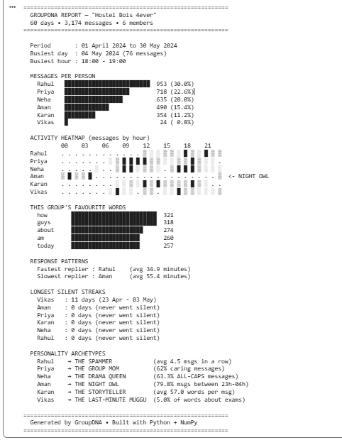

# GroupDNA - WhatsApp Group Chat Analyzer

GroupDNA reads an exported WhatsApp chat (.txt) and prints a report about the group, kind of like Spotify Wrapped but for your friend group. It was made as the Week 1 minor project at The Unlox Academy using the hostel_bois.txt dataset.

## What the report shows

- How many messages each person sent and the date range of the chat
- The busiest day and the busiest hour of the group
- An activity heatmap made with a NumPy matrix (people x 24 hours)
- The most used words in the group and per person
- Who replies fastest and slowest, and each person's longest silent streak
- A personality archetype for every member (Spammer, Group Mom, Night Owl, Storyteller, Drama Queen, Ghost, Comedian, Question Master), plus one I added called The Last-Minute Muggu for the person who always talks about exams and deadlines

The parser also handles system messages, media omitted, deleted messages, multi-line messages and empty lines.

## Rules I followed

I only used basic Python (strings, lists, dicts, sets, loops, functions), NumPy, and datetime for the dates. I did not use pandas, matplotlib, regex, collections.Counter or any other library. All the counting is done with normal dictionaries and the heatmap is printed with block characters.

## How to run

1. Open the notebook in Google Colab.
2. Upload hostel_bois.txt from the files panel on the left.
3. Click Runtime > Run all.

## Files

- GroupDNA_Vrinda_K_M_week_1.ipynb
- hostel_bois.txt
- screenshot.png
- README.md
